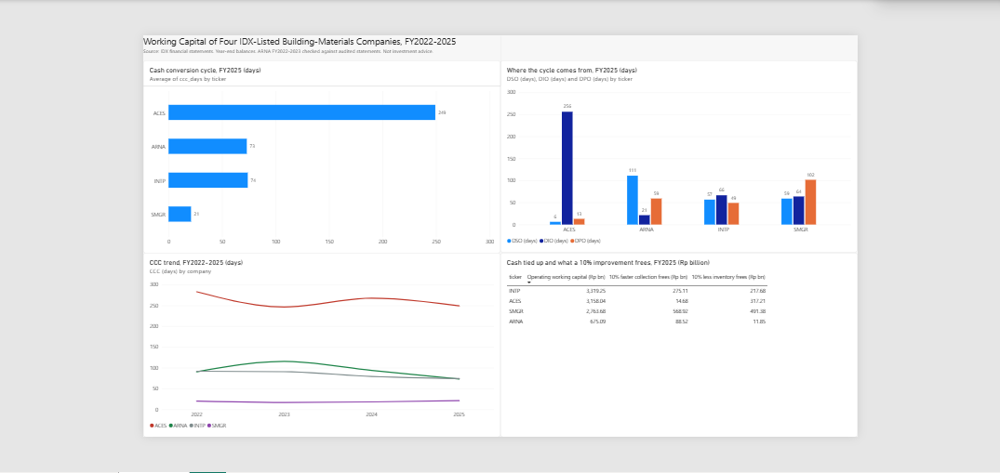

# Working Capital Radar

How long do four listed Indonesian building-materials companies wait to turn spending into cash? This project answers that with a dbt pipeline on DuckDB and a Power BI dashboard, using their annual financial statements for FY2022-2025.

The full write-up is in the memo: [memo.pdf](memo.pdf).

## What I found (FY2025)

- **ACES** collects in 6 days but holds inventory for 256 days. Its cash sits in stock, and its receivables are small.
- **SMGR** has a cash cycle of 21 days against 74 for INTP. The two collect and stock at similar speeds. SMGR pays suppliers in 102 days and INTP in 49.
- **ARNA** takes 111 days to collect. In FY2023, 94% of its trade receivables were owed by related parties, and one distributor accounted for 78% of the total and 72% of net sales.

## Data

Consolidated annual financial statements of ACES, ARNA, INTP and SMGR, taken from the IDX Excel files for FY2022-2025 (two reports per company, each with a comparative year). Five items per company and year: net sales, cost of goods sold, trade receivables, inventories and trade payables. Some companies report in full rupiah and others in millions, so the unit is stored with each row and converted to Rp billion in the staging model.

`seeds/financials.csv` holds the 16 company-years. `extraction_audit.csv` lists the source sheet and row of each extracted number.

## Method

- DSO = trade receivables / net sales x 365
- DIO = inventories / cost of goods sold x 365
- DPO = trade payables / cost of goods sold x 365
- CCC = DSO + DIO - DPO

Year-end balances are used, not averages. The what-if columns assume that 10% less receivables or 10% less inventory frees 10% of that balance. It is a scenario, not a forecast.

## Checks

dbt runs six tests: one row per company and year, positive values, recognised units, and no missing ticker, year or CCC value. ARNA's FY2022 and FY2023 figures were checked line by line against the audited FY2023 statements (statement of financial position and Notes 6, 22 and 23).

## Run it yourself

    pip install dbt-duckdb
    dbt build
    python export_for_powerbi.py

You need a dbt profile named `working_capital` (type `duckdb`) in your `profiles.yml`. The Power BI file reads `ccc_by_company_year.csv`, so point its data source at your own copy if you open it elsewhere.

## Limits

Four companies are too few for sector averages. Year-end balances can distort seasonal businesses. The related-party split was examined for ARNA FY2022-2023 only. This is an analysis of public information, not investment advice.

## Related

[Receivables Radar](https://github.com/sri-setiowati/receivables-radar), a collection dashboard for businesses that sell on credit.

## Contact

Sri Setiowati, Sidoarjo, Indonesia

[LinkedIn](https://linkedin.com/in/sri-setiowati) · [GitHub](https://github.com/sri-setiowati)
